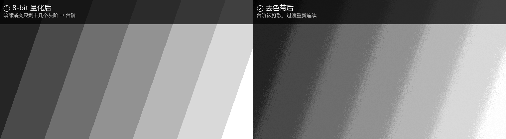
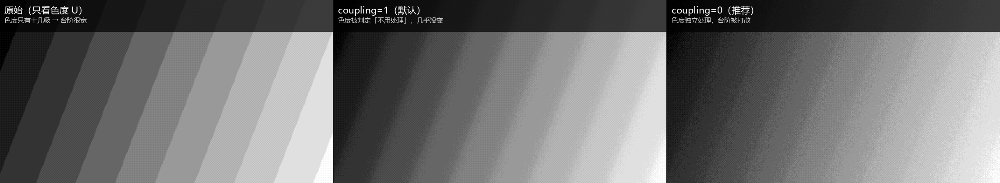
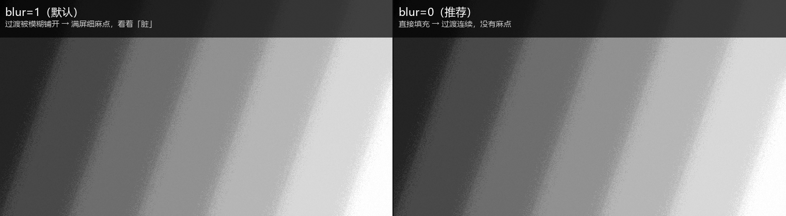

# ffmpeg-deband-tool

一个把 FFmpeg 的 `deband` 滤镜封装成「双击就能用」的 Windows 工具，专门对付视频里的**色带（banding）**。

支持 SDR 10-bit 母版、8-bit 兼容版、NVENC 硬件加速、以及 HLG HDR（杜比视界 8.4 的底层）五种输出。

> 不是商业软件，就是一套写着玩的脚本。GPL-3.0，随便改、随便发。

---

## 为什么需要它

直接用 FFmpeg 去色带，有四个坑，踩一个就白做：



<sub>合成示意图：暗部渐变被量化成十几个灰阶后出现台阶（左），去色带把台阶打散、过渡重新连续（右）。</sub>

**1. 不去色带直接重编码，色带会更严重**

| | 色带台阶宽度 |
|---|---:|
| 原始素材 | 31.6 px |
| 直接重压一遍（不处理） | **80.1 px** |
| 去色带之后 | 3.5 px |

8-bit 重新量化会把相邻的台阶合并成**更宽**的台阶。「我压了一遍怎么更花了」就是这个原因。

**2. `coupling` 默认是开的，反而压制色度去色带**

| 参数 | 色度 U 台阶 |
|---|---:|
| 不处理 | 8.7 px |
| `coupling=1`（默认） | 5.8 px |
| `coupling=0` | **2.5 px** |

`coupling=1` 让色度参考亮度的判定结果。而蓝紫色暗部恰恰是「亮度很平、色度台阶很大」，于是色度被判定成「不用处理」，直接放过。



<sub>合成示意图：只看色度 U 平面。原始色度只有十几级、台阶很宽（左）；`coupling=1` 几乎原封不动（中）；`coupling=0` 才真正把台阶打散（右）。</sub>

**3. `blur=1` 会让画面发「脏」**

`deband` 发现色带后，默认用一个模糊把过渡铺开——这些幅度只有半个灰阶的中间值密密麻麻铺满整片渐变，看起来就是一层麻点。关掉它（`blur=0`）：

| | 头发高频 | 脸部高频 | 色带台阶 |
|---|---:|---:|---:|
| `blur=1` | 1.38 | 1.29 | 3.8 px |
| **`blur=0`** | **0.57** | **0.75** | **3.5 px** |

「脏」降了一半，色带反而更少。



<sub>合成示意图：同一张带色带的渐变。`blur=1`（左）把过渡模糊铺开，形成一层细麻点；`blur=0`（右）直接填充，过渡连续、没有麻点。</sub>

**4. 8-bit 输出治不了色度色带**

8-bit 4:2:0 的色度总共只有二三十个量化级，去色带产生的中间色阶存不进去。实测 8-bit 版色度指标几乎不动（8.7 → 8.7），10-bit 版是 8.7 → 2.4。**色度色带只有 10-bit 输出才真正治得了。**

---

## 快速开始

### 1. 装 FFmpeg

下载 [gyan.dev](https://www.gyan.dev/ffmpeg/builds/) 的 full build，解压后把 `bin` 目录加进系统 PATH。

### 2. 拿到脚本

**推荐**：在 [Releases](../../releases) 页下载 `ffmpeg-deband-tool-vX.zip`，解压即用。

或者 `git clone` 本仓库。

> ⚠️ 不要直接在网页上「右键 → 链接另存为」保存 `.bat`。那样拿到的是 LF 换行，Windows 批处理会解析失败（报 `'xxx' is not recognized`）。ZIP 和 clone 都会保留 CRLF。

### 3. 跑

双击 `src/去色带-单文件.bat`：

```
1. 弹出文件选择框 → 选视频
2. 选模式（1-5）
3. 等
```

输出就在源文件旁边，文件名自动加后缀；重名会自动加编号，**不会覆盖原文件**。

> 全部逻辑都在 `去色带-单文件.bat` 里，一个文件就能跑。
> `src/去色带.bat` + `src/去色带.ps1` 是早期版本，功能完全一样，逻辑拆在 ps1 里。

### 命令行 / 批量

```bat
去色带-单文件.bat "D:\video\abc.mp4" 1
```

第二个参数是模式号，加上就跳过所有交互：

```bat
for %%f in ("D:\video\*.mp4") do (
    call "去色带-单文件.bat" "%%~ff" 5
)
```

---

## 五种模式

| | 模式 | 画质 | 1440p60 耗时 | 说明 |
|---|---|---|---|---|
| **1** | 10-bit HEVC 母版 | 最好 | 15–20 分钟 | 自己看、收藏 |
| **2** | 8-bit H.264 兼容版 | 亮度色带改善，色度治不了 | 3–5 分钟 | 剪辑、上传、老设备 |
| **3** | 20 秒样片 | 同模式 1 | 约 2 分钟 | 先看效果再跑整片 |
| **4** | NVENC 硬件加速 | 接近模式 1，略弱 | **约 3 分钟** | 赶时间、批量 |
| **5** | HLG HDR | 同模式 1，走 HDR 通路 | 15–20 分钟 | 杜比视界 / HDR 屏 |

### 模式 4 的实测代价

| 编码器 | 速度 | 色带台阶 |
|---|---:|---:|
| x265 medium | 6.4 fps | **6.8 px** |
| x265 fast | 10.6 fps | 12.3 px |
| NVENC cq17 + AQ | **49–53 fps** | 11.1 px |

快 5–8 倍，台阶从 6.8 px 变 11.1 px。放大 8 倍才看得出差别。

> NVENC 必须开 `-spatial-aq 1 -aq-strength 12`，否则暗部会明显糊回去；码率压太低（cq 21）反而更差，cq 17 就够。

### 模式 5（HLG）说明

杜比视界 8.4 的底层就是 HLG，所以模式 5 输出的是「能当 8.4 底层用」的素材：

```
zscale=rin=limited:tin=bt709:min=bt709:pin=bt709:t=arib-std-b67:m=bt2020nc:p=bt2020:r=limited:npl=100
-color_primaries bt2020 -color_trc arib-std-b67 -colorspace bt2020nc
```

**它不是什么**：没有杜比视界的 RPU 动态元数据。那需要 Dolby 调色工具链导出的 DV XML，`dovi_tool` 只能从现成的 DV XML 或 HDR10+ 元数据生成。手工塞一个静态 L1 属于「假杜比视界」，播放器可能不认或映射错误，本工具不做。

**什么时候用**：在 HDR / DV 屏幕上，SDR 内容会让设备自己做 SDR→HDR 拉伸，8-bit 的台阶被放大成可见色带、抖动被放大成噪点。给设备一个原生 HDR 信号，就跳过这一步。

---

## 参数怎么调

滤镜链的核心：

```
format=yuv420p10le,deband=1thr=0.065:2thr=0.065:3thr=0.065:range=28:blur=0:coupling=0
```

| 参数 | 默认 | 说明 |
|---|---|---|
| `1thr`…`4thr` | `0.065` | 判定阈值。0.02 温和（留残带），0.08 很猛（抹细节、冒噪点） |
| `range` | `28` | 搜索半径。台阶宽就调大 |
| `blur` | **`0`** | **保持 0**。改回 1 画面立刻发「脏」 |
| `coupling` | **`0`** | **保持 0**。改回 1 色度去色带失效 |
| `crf` | `17` | 数字越大体积越小 |

### 阈值不是越高越好

同一段素材测出来的拐点：

| 阈值 / range | 亮度台阶 | 体积 |
|---|---:|---:|
| 0.05 / 24 | 3.8 px | 76.8 MB |
| **0.065 / 28** | **3.7 px** | 112.5 MB |
| 0.08 / 32 | 3.4 px | 150.8 MB |

阈值越高，`deband` 引入的抖动纹理越多（平坦区非零梯度 56.9% → 63.1%），而抖动最吃码率。0.08 让体积翻倍只换来 0.3 px。

### crf 也有拐点

| crf | 码率 | 亮度台阶 | 色度台阶 |
|---|---:|---:|---:|
| 19 | 45 Mbps | 3.7 px | 2.5 px |
| **17** | 69.8 Mbps | **3.3 px** | 2.3 px |
| 15 | 100 Mbps | 3.6 px ↑ | 2.2 px |

亮度台阶不是单调的——crf17 最好，再往上反而回升。只有色度还在线性改善。

### 降噪没用

这支素材平面区噪声 σ=0，时域也是 0（数字直录，没有传感器噪声）。而且：

| 方案 | 亮度台阶 | 细节保留 |
|---|---:|---:|
| 只去色带 | 3.8 px | 100% |
| 先降噪再去色带 | **4.1 px** | 95.9% |

三项全输。`deband` 引入的细微抖动恰好起到「天然抖动」作用，降噪把它抹掉，台阶反而更整齐、更明显。**先降噪再色带是给有真实噪声的素材准备的，不适合这类数字直录。**

---

## 目录结构

```
.
├── LICENSE                    GPL-3.0
├── README.md
├── src/
│   ├── 去色带-单文件.bat      ← 主程序，双击即用
│   ├── 去色带.bat             早期版启动器
│   └── 去色带.ps1             早期版核心逻辑
├── docs/
│   ├── 使用说明.md            详细用法与 FAQ
│   └── 调参记录.md            完整的实测数据
└── analysis/
    └── measure_banding.py     色带指标测量脚本（需要 ffmpeg + Python）
```

---

## 关于素材

**本仓库不包含任何视频素材。**

README 和 docs 里的数据来自一段 2560×1440 / 59.94fps / 2 分 37 秒的游戏录屏，仅用于说明参数效果。该素材的版权归原权利人，不在本仓库中分发，也不受本仓库许可证约束。

---

## 许可

[GNU General Public License v3.0](LICENSE) 或更新版本。

```
ffmpeg-deband-tool
Copyright (C) 2026 AngesDitgialIO

This program is free software: you can redistribute it and/or modify
it under the terms of the GNU General Public License as published by
the Free Software Foundation, either version 3 of the License, or
(at your option) any later version.

This program is distributed in the hope that it will be useful,
but WITHOUT ANY WARRANTY; without even the implied warranty of
MERCHANTABILITY or FITNESS FOR A PARTICULAR PURPOSE.  See the
GNU General Public License for more details.
```
